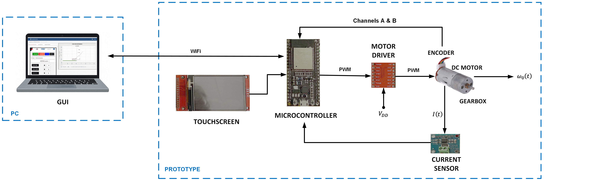

# Pedagogical DC Motor Control Platform

This repository contains the software developed for an **IoT-based pedagogical platform for teaching automatic control and embedded systems** using a DC motor system controlled by an ESP32 microcontroller.

The platform allows students to interact with a real physical system and analyze motor responses using different control signals.

---

## System Overview

The system consists of an ESP32-based DC motor controller and a MATLAB App Designer graphical interface that allows users to send control commands and visualize motor signals in real time.

The system supports both **MQTT communication** (HiveMQ Cloud, TLS) and **direct TCP/IP communication via WiFi** (ESP32 hotspot).



---

## Repository Structure

```
Pedagogical-DC-Motor-Prototype
│
├── ESP32_Firmware
│   ├── ESP32_Firmware_V1_1
│   │   └── ESP32_Firmware_V1_1.ino      ESP32 firmware (Step, Sine, PID)
│   ├── TFT_eSPI_config
│   │   └── User_Setup.h                 display configuration (TFT_eSPI)
│   └── README.md
│
├── MATLAB_App_Designer
│   ├── ESP32_MQTT_DCmotor_New_Certificate_V1_1.mlapp   MATLAB GUI
│   ├── isrgrootx1.pem                   root certificate for HiveMQ Cloud (TLS)
│   ├── *.png, *.jpg                     images used by the GUI (same folder as the .mlapp)
│   └── README.md
│
├── prototype_architecture.png
└── README.md
```

---

## Features

- Step response experiments
- Sinusoidal input experiments
- PID control of motor speed (continuous and discrete, optional derivative filter N)
- First-order IIR low-pass digital filters for speed and current
- Real-time visualization of motor signals
- Data export to `.mat` files
- Communication using MQTT or TCP/IP
- Current measurement using INA219
- Touchscreen interface on ESP32

---

## Hardware Components

- ESP32 microcontroller (ESP32 DevKit V1)
- DC motor with encoder
- TB6612FNG motor driver
- INA219 current sensor
- ILI9341 TFT touchscreen display (XPT2046 touch controller)

---

## Quick Start

1. Firmware: see [`ESP32_Firmware/README.md`](ESP32_Firmware/README.md).
2. GUI: see [`MATLAB_App_Designer/README.md`](MATLAB_App_Designer/README.md).

Both files contain a **USER SETTINGS** block with placeholders (`YOUR_...`)
that must be replaced with your own WiFi and MQTT broker data.

---

## Educational Purpose

This platform was developed as a teaching tool for courses related to:

- Automatic Control
- Embedded Systems
- Internet of Things (IoT)

Students can analyze real-time system responses and experiment with different control strategies.

---

## Authors

Luis Ricardo Rivera-Goitia  
Luis Enrique González-Jiménez  

Department of Electronics, Systems and Informatics  
ITESO – Universidad Jesuita de Guadalajara
